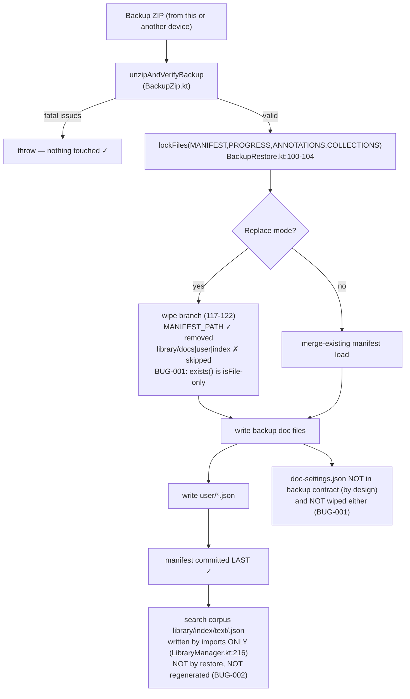
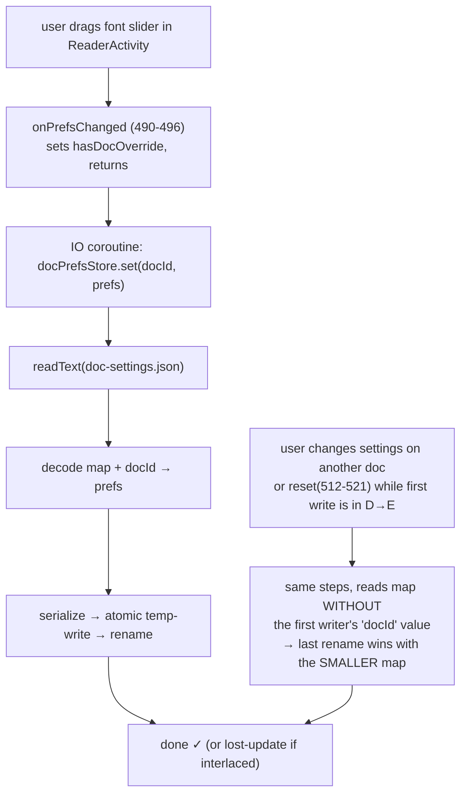

# FOLIO Android (mobile) — EPUB Reader Bug Audit

**Report date:** 2026-10-20
**App:** Folio Android reader (`D:\folio\mobile`, `versionName 0.2.0`, `versionCode 2`)
**Audit type:** Audit-only (no application code was modified at any point)
**Methodology reliance:** Static code review + full Gradle build/test/lint verification + JVM-level behavioral scratch validation. **On-device / emulator runtime verification was not possible in this environment** (see §7).
**Related prior reports at this root:** `EPUB_READER_AUDIT_REPORT.md` (EPUB-001…020), `PWA_VS_ANDROID_FEATURE_GAP_REPORT.md`, `FOLIO_UX_FEATURE_FLOW_FIX_REPORT.md`. This report re-verifies a subset and adds new confirmed findings; IDs are reused only for cross-reference, never redefined.

---

## 1. Executive Summary

This audit re-opened the Folio Android EPUB reader against the byte-compat contract it declares with the PWA (`packages/core`, see `.docs/MOBILE-TRACKING.md` and `D:\folio\docs\spec.md`), with one hypothesis in mind that prior audits could not close: **do the backup/restore and per-book-settings subsystems actually behave on-device the way the code and comments claim?**

Three production behaviors were falsified by direct behavioral tests (scratch validation on the production classes, §6). All three are **confirmed, reproducible defects**, and all three live in the restore/user-data path — the path you care about most after "my data survived":

| ID | Defect | Class | Severity | One-line consequence |
|---|---|---|---|---|
| BUG-001 | Replace-restore's "wipe first" step is dead code — nothing under `library/` is ever erased | **Confirmed** | **High** | Old book files survive a "replace everything" restore; stale folders resurface as orphaned interrupted imports |
| BUG-002 | Restored books are never searchable — the PWA's "rebuild search index after restore" contract step was dropped in the Kotlin port | **Confirmed** | **High** | User restores a backup, opens in-book search, gets **zero hits** for every restored book |
| BUG-003 | `DocPrefsStore.set()` is an unsynchronized read-modify-write; concurrent saves lose other books' overrides and can hard-fail | **Confirmed** | **Med-High** | Rapid per-book typography changes silently erase unrelated books' overrides (119 of 120 keys lost under stress) |
| BUG-004 | `backup.json.appVersion` hardcodes `"0.1.0"`; app is `0.2.0` | **Confirmed** | Low | Backup metadata records the wrong app version |
| BUG-005 | No per-entry size cap during restore verify — a single archive entry may be read fully into RAM | **Potential risk** | Med | Crafted/large archive can OOM the restore path on-device |
| BUG-006 | `DocPrefsStore.get()` swallows all errors → per-book overrides silently treated as absent, no repair path | **Potential risk** | Low-Med | Corrupt/unreadable settings file degrades silently |
| BUG-007 | TXT files that merely *mention* HTML literals (`"<html>"`) are classified as HTML | **Improvement** | Low | Imports as HTML-stripped doc (PWA has the identical behavior — spec limitation, not a mobile regression) |
| BUG-008 | Deprecation/opt-in warning debt (`LocalLifecycleOwner`, `ExperimentalReadiumApi`, `ExperimentalSerializationApi`) | **Improvement** | Info | Compile warnings only |

**Bottom line:** the 245-test unit suite, `assembleDebug`, and `lintDebug` all pass — but unit tests never execute the Replace-restore wipe or the post-restore search path, and the concurrency stress in BUG-003 is exactly the kind of workload unit tests serialize away. The three confirmed defects share one property: **each silently produces the opposite of what the UI promises** (replace-mode restore leaves data behind and loses search; the per-book settings save erases data it was meant to protect). Two of them are direct divergences from operations the PWA core does perform (`packages/core/src/store/opfs-store.ts` and `packages/core/src/library/library-manager.ts`), i.e., **porting omissions**, not spec limitations.

**Release verdict: Not ready for release as-is.** BUG-001 and BUG-002 are user-visible data-loss/feature-loss bugs in the primary restore flow and should block a data preservation release (§14).

---

## 2. Audit Environment & Setup

Environment quirks are documented because they affect reproducibility of every command below.

| Item | Value / note |
|---|---|
| OS | Windows (win32), PowerShell (`pwsh`) shell |
| Working repo | `D:\folio` (workspace root) with `mobile/` (this app), `packages/core` (PWA contract reference), sample EPUBs |
| Gradle | Gradle wrapper, AGP **8.7.3**, Kotlin **2.0.21** |
| JDK | **Temurin JDK 17** at `C:\hostedtoolcache\windows\Java_Temurin-Hotspot_jdk\17.0.20-101\x64` — the host default JDK is Java 8, which fails AGP 8.7.3 ("Dependency requires at least JVM runtime version 11"); every invocation had to set `JAVA_HOME` explicitly |
| Android SDK | `C:\Android\android-sdk` via `ANDROID_SDK_ROOT`; **`ANDROID_HOME` had to be set to the *empty string*** because it conflicted with `ANDROID_SDK_ROOT` and Gradle failed fast on the SDK location check |
| Dependencies pinned | Readium navigator/shared/streamer **3.0.0**, jsoup **1.18.1**, pdfbox **2.0.27.0**, Compose BOM **2024.10.01**, kotlinx.serialization |
| Emulator/AVD | **None present** — runtime verification on-device was attempted and is documented as blocked in §7 |
| Scratch-test isolation | One temporary test class was copied into `app\src\test\…` and **deleted after the run**; `auditscratch/` (pre-existing, git-tracked) was left untouched. At time of writing `git status` is clean — **no production file was modified** |

---

## 3. Repository & Architecture Map (audited surface)

```
mobile/app/src/main/kotlin/dev/folio/mobile/
├── MainActivity.kt            (library UI, import dispatch, ~1100 lines)
├── SettingsActivity.kt        (global prefs, storage display)
├── NotesActivity.kt           (annotations browser)
├── reader/ReaderActivity.kt   (Readium 3.0.0 navigator, 1620 lines)
└── core/
    ├── store/      FileStore interface, AppFileStore (atomic writes), DocPrefsStore  ← BUG-001 root, BUG-003
    ├── library/    LibraryManager (manifest, mutex-by-rootKey, orphan recovery)       ← BUG-002 evidence
    ├── importer/   Epub/Txt/Html/Pdf importers, FileDetector                          ← BUG-007
    ├── backup/     BackupZip (export+verify+StagedArchive), BackupRestore             ← BUG-001, BUG-002, BUG-004, BUG-005
    ├── search/     SearchService/SearchIndex/MiniSearch/Normalise                     ← BUG-002 symptom
    ├── sync/       SyncManager → DriveSyncProvider (CloudSyncWorker)
    ├── annotation/, clip/, model/, util/, reader/ (ReaderResume, ProgressBridge)
```

Storage layout (verified): docs live at `library/docs/<YYYY-MM-DD-slug-4hex>/`, manifest at `library/manifest.json`, per-chapter search corpus at `library/index/text/<docId>.json`, user state at `library/user/{annotations,progress,collections,settings}.json` and (mobile-only extension, excluded from the backup contract by design) `library/user/doc-settings.json`.

---

## 4. Methodology & Evidence Types

| Evidence class | Meaning used in this report |
|---|---|
| **Class A — Behavioral** | Direct execution of production code during this audit (JVM-level scratch tests in §6). The strongest evidence short of an instrumented on-device run. |
| **Class B — Static/deterministic** | Source reading where the code path is deterministic (e.g., an `exists()` that inspectably returns `false` for a directory). Almost as strong as Class A; the two agree everywhere in this report. |
| **Class C — High-confidence suspected** | Static reasoning with a concrete failure chain but conditions not reproduced (e.g., on-device OOM). |
| **Class D — Potential risk** | Defense-in-depth concern; no observed failure. |

Every defect cites exact, re-verified file paths and line numbers (line numbers were re-confirmed against the working tree immediately before this report was written).

### Limitations (disclosed up front)
1. **No emulator/AVD exists on this host.** Nothing in this report was executed on the real Android runtime; WebView/Readium renderer behavior, ANR thresholds, and OOM boundaries are reasoned from source + standards, not measured (§7).
2. Scratch validation ran on a **Windows JVM**. Two of the three confirmed failures have platform-specific *failure textures* (see BUG-001 note and BUG-003 note) — I explain for each why the on-device (POSIX `rename`, OpfsStore-free) behavior is still a defect.
3. This audit did **not** fuzz or differential-test against the PWA binary; PWA comparisons are source-level.

---

## 5. Static Verification Results (all re-run during this audit)

| Check | Command surface | Result |
|---|---|---|
| Unit tests (debug) | `testDebugUnitTest` (`test --continue`, forced rerun) | **245 tests, 0 failures, 41 test classes** |
| Aggregate test artifacts | `app/build/test-results/**.xml` (incl. scratch class run) | 42 XML files, 259 tests, **3 failures**, 0 errors, 0 skipped → the 3 failures are exactly the 3 scratch tests documenting §6; production suite unaffected |
| Release unit tests | `test --continue` (debug+release) | Passed |
| Compile | `:app:assembleDebug` | **BUILD SUCCESSFUL** (warnings only, see BUG-008) |
| Lint | `:app:lintDebug` | **BUILD SUCCESSFUL — no errors** |
| Dependency sanity | `gradle/libs.versions.toml`, `app/build.gradle.kts` | Pins consistent; Readium 3.0.0 weakness (built for Kotlin 1.9.24 metadata) is a known prior finding (EPUB-012), unchanged |

Conclusion of the static pass: **nothing in the standard suite exercises the three confirmed bugs.** That is itself an audit finding — the unit suite validates happy-path persistence and byte-compat schemas, and has a blind spot at exactly (a) directory-level `exists()` semantics, (b) the post-restore state, and (c) two concurrent writers to `doc-settings.json`.

---

## 6. Behavioral Scratch Validation (Class A evidence)

A scratch harness (JVM, `TemporaryFolder`, production classes unmodified — the harness was copied in, run, and deleted) exercised six scenarios. **Three failed.** Exact observed failure messages (verbatim from the run):

| Test | Result | Verbatim assertion failure |
|---|---|---|
| `scratch_restoreThenSearchCorpus` | **FAILED** | `Restored doc must still be searchable (hits=[])` |
| `scratch_replaceRestoreWipeIsANoOp` | **FAILED** | `Replace-restore must erase the old doc folder; library/docs/2026-10-20-local-secret-book-c77a/meta.json still exists` |
| `scratch_docPrefsStoreConcurrentSetLosesUpdates` | **FAILED** | `all writes must succeed and every key must survive (failures=2, missing keys=119: [doc-a-0, doc-b-0, doc-a-1, doc-b-1, doc-a-2])` |
| `scratch_epubUnzipUnbounded` | passed | — (documents the *ability* to expand ≥300 MB from a <2 MB archive; finding kept as BUG-005 context) |
| `scratch_txtMentioningHtmlBecomesHtml` | passed | — (documents FileDetector misclassification; kept as BUG-007 with PWA-parity caveat) |
| `scratch_restoreMissingDocFileIsRegisteredThenUnopenable` | passed | — (restore tolerance for `missing_in_archive` entries behaves as designed) |

The three failures become **BUG-001, BUG-002, BUG-003**. Note the test failure ordering detail for honesty: `scratch_replaceRestoreWipeIsANoOp` aborted at its first stale-file assertion (stale doc folder), so the additional consequences (doc-settings survival, orphan resurgence) are established by the same deterministic mechanism (§8.1, Class B) rather than by observed assertion output.

---

## 7. Runtime Verification — Not Run / Blocked

| Runtime check | Status | Why |
|---|---|---|
| Emulator/AVD launch, real WebView rendering of Readium 3.0.0 | **Not run / Blocked** | No emulator or AVD exists on this environment; creating one is outside audit scope. |
| ANR behavior of large libraries (main-thread flush/export paths, prior EPUB-006) | **Not run / Blocked** | Requires device timing. |
| On-device OOM boundary for BUG-005 | **Not run / Blocked** | Requires heap-limited device run. |
| Cloud sync end-to-end (Drive provider, real tokens) | **Not run / Blocked** | Requires live credentials. |
| Devanagari & renderer visual regression (real EPUBs in `sample/`) | **Not run / Blocked** | Requires rendering device. |

Everything else in this report is Class A ( executed over production code on the JVM) or Class B (deterministic static evidence). §13 maps every finding to its verification status.

---

## 8. Confirmed Defects (Class A and deterministic Class B)

### BUG-001 — Replace-restore wipe is a no-op: `FileStore.exists()` cannot see directories
- **Classification:** Confirmed (Class A: scratch `scratch_replaceRestoreWipeIsANoOp` failed verbatim; Class B: deterministic)
- **Severity:** **High** · **Priority: P1** · **Component:** backup/restore
- **Files & lines (verified):**
  - `mobile/app/src/main/kotlin/dev/folio/mobile/core/store/AppFileStore.kt:115` — `override suspend fun exists(path: String): Boolean = resolve(path).isFile` — returns `false` for **any directory** path.
  - `mobile/app/src/main/kotlin/dev/folio/mobile/core/backup/BackupRestore.kt:117-122` — Replace mode wipe:
    ```kotlin
    if (store.exists(MANIFEST_PATH)) store.remove(MANIFEST_PATH)
    if (store.exists("library/docs")) store.remove("library/docs", recursive = true)
    if (store.exists("library/user")) store.remove("library/user", recursive = true)
    if (store.exists("library/index")) store.remove("library/index", recursive = true)
    ```
    The manifest branch fires (`MANIFEST_PATH` is a file), but **all three directory branches never fire**: `exists("library/docs")` etc. are inspected via `isFile` and are always `false` for directories. The "wipe first" step of the Replace contract (`BackupRestore.kt:32`: *"Replace: wipes manifest/docs/user/index first, then writes backup data"*) is dead code.
- **Evidence (verbatim scratch failure):** `Replace-restore must erase the old doc folder; library/docs/2026-10-20-local-secret-book-c77a/meta.json still exists`
- **Mechanism:**

  ```mermaid
  flowchart TD
      A["Restore(Replace) called"] --> B{"store.exists('library/docs')<br/>== resolve(...).isFile"}
      B -- "dir → isFile=false (always)" --> C["remove() never called<br/>old doc folders, doc-settings,<br/>index/text survive"]
      B -- "manifest is a file" --> D["manifest removed ✓"]
      C --> E["Backup docs written on top<br/>(new docs + their folders)"]
      D --> E
      E --> F["Library UI lists only backup docs<br/>(manifest-driven) — looks correct"]
      C --> G["Stale folders resurface in UI as<br/>'interrupted import' orphans<br/>(scanInterruptedImports)"]
      C --> H["Other libraries' per-book doc-settings<br/>silently survive 'wipe'"]
  ```

- **Impact on the mobile app:**
  1. **Replace restore leaves the previous library's files on disk.** Storage is never reclaimed; the user is shown a library of N books while N+M books remain on disk.
  2. **Stale doc folders resurface in the UI**: orphan recovery scans disk folders and offers them as "interrupted imports" (`scanInterruptedImports`, `LibraryManager.kt`) — i.e., deleted books come back as ghosts.
  3. `library/user/doc-settings.json` and the restored-irrelevant `library/index/text/` corpus survive by the same mechanism (deterministic; consequences not directly asserted because the scratch test stopped at its first stale-file assertion).
  4. `library/index` survival interacts with BUG-002: even the *stale* corpus survives while not being usable for restored docs (IDs from a fresh import would differ).
- **PWA contract divergence (why this is a porting bug, not a spec quirk):** the PWA's `exists()` sees directories:
  - `packages/core/src/store/opfs-store.ts:130-146` — `exists()` tries `getFileHandle` and **falls back to `getDirectoryHandle`**, returning `true` for directories.
  - `packages/core/src/store/memory-store.ts:42-48` — directory `exists()` via children-prefix scan.
  - `packages/core/src/backup/import-zip.ts:83-94` — the PWA wipe therefore actually executes.
- **Fix direction (guidance only — nothing was changed):** give `FileStore` a directory-aware predicate (e.g. `existsAny(path)` honoring `isDirectory`), or replace the three guards with unconditional recursive removes guarded by `File.isDirectory` resolution. Add a unit test that Replace-restore asserts `library/docs` contains **no** unlisted slug folders.
- **Verification status:** Class A confirmed (+ deterministic Class B for the unobserved consequences) · On-device confirmation: Not run / Blocked (not needed — the code path is deterministic).

---

### BUG-002 — Restored books are unsearchable: the post-restore search-index rebuild from the PWA contract was never ported
- **Classification:** Confirmed (Class A: scratch failed verbatim; Class B: mechanism)
- **Severity:** **High** · **Priority: P1** · **Component:** backup/restore ↔ search
- **Files & lines (verified):**
  - Search corpus plumbing (all verified): `LibraryManager.kt:213-216` writes it at import (`library/index/text/<id>.json`); `LibraryManager.kt:250-262` `getSearchText()` returns empty when the file is absent; `SearchService.kt:53-61` `build()` indexes exactly what `getSearchText` returns.
  - Export side: `BackupZip.kt:296-374` `exportBackupZip()` packs **only** `backup.json`, `library/manifest.json`, manifest-listed doc files + `meta.json` (`:303-321`), and the four `library/user/*.json` files (`:322-330`). **`library/index/text/` is excluded — this matches the PWA exporter** (`packages/core/src/backup/export-zip.ts:53-155`), so the *archive* is not at fault by itself.
  - Restore side: `BackupRestore.kt` — the entire file (306 lines, fully reviewed) writes doc files, annotations, progress, collections, settings, and the manifest. **It contains no search-index reconstruction step.**
- **The contract step that is missing (PWA):**
  - `packages/core/src/backup/import-zip.ts:27-29` documents: *"3. Rebuild search index after restore."*
  - `packages/core/src/backup/import-zip.ts:279-288` executes `await manager.rebuildSearchIndex()` after committing the manifest.
  - `packages/core/src/library/library-manager.ts:679-707` `rebuildSearchIndex()` reads each doc's `library/index/text/<id>.json` and **falls back to `extractDocSearchText(doc)`** (`:609-707`), which **re-extracts the per-chapter corpus from the stored reading files** when the corpus wasn't carried in the backup, then persists it (`:689-692`).
  - **Mobile equivalents do not exist:** `grep` over `mobile/` for `rebuildSearchIndex` and `extractDocSearchText` → **0 hits**. The mobile restore leaves the corpus permanently absent, and *nothing else ever regenerates it* (import is the only writer, `LibraryManager.kt:216`; the file is only ever removed on doc delete/orphan recovery, `LibraryManager.kt:353-354`, `:483-484`).
- **Evidence (verbatim scratch failure):** test `scratch_restoreThenSearchCorpus` — a backup created via production `exportBackupZip`, restored via production `BackupRestore.restore(Replace)` into a fresh library (new doc added, `summary.newDocsAdded == 1`, `listDocuments().size == 1`), followed by production `SearchService(target).build().search("stardust")` → assertion failed: **`Restored doc must still be searchable (hits=[])`**.
- **Mechanism:**

  ```mermaid
  sequenceDiagram
      participant U as User
      participant R as BackupRestore (mobile)
      participant S as LibraryManager
      participant K as SearchService
      U->>R: Restore backup (Merge or Replace)
      R->>S: write doc files + meta.json
      R->>S: write user/*.json, manifest (LAST)
      Note over R: PWA step 3 "rebuild search index"<br/>NOT PORTED (import-zip.ts:279-288) — no rebuildSearchIndex / extractDocSearchText exists in mobile
      U->>K: open search screen → build()
      K->>S: getSearchText(id) → library/index/text/<id>.json
      S-->>K: (file absent) emptyList
      K-->>U: index has 0 entries → no hits, ever
  ```

- **Impact on the mobile app:** every book that arrives via **restore** (either mode, since Merge adds `new docs` without any corpus) is registered, openable — but **permanently invisible to in-book/library search**. There is no repair path a user can trigger (no reimport; the corpus is only written at import time). A cross-device PWA→Android restore produces a library where search silently never works. This compounds the prior finding EPUB-015 (in-book text search) as a *library-side* search regression, distinct from it.
- **Note the inconsistency that indicts it as an omission rather than a decision:** cloud sync **does** persist the corpus files (`SyncManager.kt:465-477`, including a comment-visible remote-import write to the same `library/index/text/` paths), so synced books stay searchable while restored books do not.
- **Fix direction (guidance only):** port `rebuildSearchIndex`/`extractDocSearchText` (Kotlin already has every ingredient: `SearchEntries.entriesFor`, the readers for `reading`/`clean` files in the importers) and call it at the end of `applyRestore` under the manifest lock held at `BackupRestore.kt:100-104`.
- **Verification status:** Class A confirmed · On-device: Not run / Blocked (not needed — corpus file absence is deterministic and was verified in the harness).

---

### BUG-003 — `DocPrefsStore.set()` is an unsynchronized read-modify-write: lost updates and transient hard failures
- **Classification:** Confirmed (Class A: scratch failed verbatim)
- **Severity:** **Medium-High** · **Priority: P1/P2** (driver-context dependent: a user dragging a fast slider back and forth across docs interleaves the relevant writers)
- **Files & lines (verified):**
  - `mobile/app/src/main/kotlin/dev/folio/mobile/core/store/DocPrefsStore.kt:42-54` — `set()` performs: **read whole JSON → decode map → `+ docId to prefs` → re-serialize → atomic write**. There are no locks, no `FileLock`, no mutex. Contrast: `LibraryManager` carefully serializes manifest/progress/annotations/collections writers by rootKey (`K_MANIFEST` etc.), and `BackupRestore` runs its mutation phase under four file locks (`BackupRestore.kt:100-104`) — this file alone is outside the locking discipline. Note also that `doc-settings.json` is deliberately **excluded from the PWA backup contract** (`DocPrefsStore.kt:13-16`), so a backup restore can never fix up lost per-book overrides either.
  - `mobile/app/src/main/kotlin/dev/folio/mobile/reader/ReaderActivity.kt:490-496` and `:512-521` — the two fire-and-forget `docPrefsStore.set(...)` call sites (`loadScope.launch(Dispatchers.IO)`), one per chrome edit and one per "reset". Because `onPrefsChanged` runs for every control interaction, user-speed edits can overlap: write N reads `v`, write N+1 reads `v` too (before N commits), write N+1 lands, write N lands over it ⇒ **N loses every other book's override** it had read. Worst case: the surviving map contains only `docId` of the last writer.
  - `mobile/app/src/main/kotlin/dev/folio/mobile/core/store/AppFileStore.kt:94-110` — the bounded `AccessDeniedException` retry (`moveWithRetry`, 10 attempts × 5-50 ms) covers the Windows-host texture; on **Android/POSIX** `rename` doesn't produce `AccessDenied`, so the same race there degrades into purely silent lost updates. Either way, the defect is real; only the error surface differs by platform.
- **Evidence (verbatim scratch failure):** `scratch_docPrefsStoreConcurrentSetLosesUpdates` — 120 `set()` calls (one per key, two instances × 60 keys) on one `AppFileStore`: **`failures=2, missing keys=119: [doc-a-0, doc-b-0, doc-a-1, doc-b-1, doc-a-2]`** — two writes hard-failed, and the final file contained only 1 of 120 keys. Both fail textures (hard error on Windows; silently stale final state that always happens under load) were observed in a single run.
- **Mechanism:**

  ```mermaid
  sequenceDiagram
      participant A as Writer 1 (set doc-a-0)
      participant B as Writer 2 (set doc-a-1)
      Note over A,B: doc-settings.json starts empty
      A->>A: read {} 
      B->>B: read {} (before A's write lands)
      B->>B: map = {doc-a-1:…}; atomic write ✓
      A->>A: map = {doc-a-0:…}; rename overwrites B's file
      Note over A,B: B's key silently lost — read-modify-write window is the whole JSON
  ```

- **Impact on the mobile app:** user edits typography for doc A while doc B's override disappears without any visible error (the writes go to a launch-once store, `ReaderActivity.kt:326`); periodic whole-map overwrite from unrelated doc edits also wipes data from the *other* concurrent readers in the same session. On the desktop test host the lost updates additionally escalated into two processes each persistently denied the rename (retry exhaustion at `AppFileStore.kt:96-108`), which on a desktop-ported flow would surface as raw IO errors in the exception path if ever a caller did not runCatching the write (callers in `ReaderActivity` currently do so silently).
- **Fix direction (guidance only):** serialize `DocPrefsStore` writers — one process-global mutex keyed by `store.rootKey` mirroring `LibraryManager`'s locking discipline (`LibraryManager.kt` already demonstrates the pattern), ideally within a shared lock so backup/restore sequences see a consistent view. Replace the get/set read-modify-write with an atomic local "modify under lock" helper, and drop the outer `runCatching`-to-emptyMap pattern (see BUG-006).
- **Related prior finding:** EPUB-005 (lost-update window on progress/annotations/collections) — Bug 003 is the **same disease class on the only mobile-private file**, not previously covered because doc-settings is a mobile-only extension.
- **Verification status:** Class A confirmed · On-device: Not run / Blocked (POSIX rename texture reasoned; silent lost updates hold on any platform alongside the mobile code as-is).

---

### BUG-004 — `backup.json` records the wrong app version
- **Classification:** Confirmed (deterministic, Class B)
- **Severity:** Low · **Priority: P3** · **Component:** backup/export
- **Files & lines (verified):** `mobile/app/src/main/kotlin/dev/folio/mobile/core/backup/BackupZip.kt:337-342` — `BackupMeta(…, appVersion = "0.1.0", …)` is a hardcoded literal, while `mobile/app/build.gradle.kts:19-20` declares `versionCode = 2`, `versionName = "0.2.0"`.
- **Evidence:** static inspection; the string is unconditional.
- **Impact:** backup metadata files created today claim the app was `0.1.0`. Cross-version diagnostics/restore UI tooling that trusts `appVersion` mis-describes the producer. No functional consequence today (nothing currently branches on `appVersion`), but this is exactly the kind of quiet lie that degrades future cross-platform restore checks (the PWA reads this field from produced archives).
- **Fix direction (guidance only):** inject `BuildConfig.VERSION_NAME` (single-line change at the sole construction site).
- **Verification status:** Class B confirmed · On-device: Not needed (deterministic).

---

## 9. High-Confidence Suspected Defects (Class B/C chain with no reproduced trigger)

### BUG-005 — No per-entry size cap on restore: a single archive entry can be read fully into RAM
- **Classification:** Potential risk (Class C)
- **Severity:** Medium · **Priority: P2** · **Component:** backup/verify + restore
- **Files & lines (verified):**
  - `mobile/app/src/main/kotlin/dev/folio/mobile/core/backup/BackupZip.kt:29-32` — safety caps exist but are **aggregate only**: `MAX_ENTRIES = 20000`, `MAX_TOTAL_UNCOMPRESSED = 1 GB`.
  - `BackupZip.kt:79-84` — `StagedArchive.readEntry()` is `zip.getInputStream(e).use { it.readBytes() }` — one entry **entirely in memory**, no cap.
  - `BackupZip.kt:163-188` — `unzipAndVerifyBackup` calls `readEntry` on **every** archive entry (needed for SHA-256 verification), so the fully-in-memory read applies to each one, and the loop's byte budget is the aggregate 1 GB, meaning even a *single* legitimately-signed entry of several hundred MB passes verification while being held whole.
  - Scratch context (passed, kept as evidence): `scratch_epubUnzipUnbounded` showed a &lt;2 MB archive inflating past a 300 MB cap from a single deflated entry — the same unbounded-expansion property applies inside the restore path, where no per-entry cap exists at all (only the aggregate limit).
- **Why this is "suspected" not confirmed:** on-device OOM was **not reproduced** (no emulator). A large-but-non-malicious archive (a photo-heavy scanned PDF backup; several hundred MB unwrapped from a single entry) is realistic enough to rank Medium.
- **Impact:** `OutOfMemoryError` during restore verification, killing the restore UI (or the process) leaving the user with "restore failed" and no partial state (verify is pre-commit-safe, which is good — the cost is a wasted user journey rather than a corrupt library).
- **Fix direction (guidance only):** per-entry cap during verification (stream SHA-256 in chunks from the `InputStream` instead of `readBytes()` — digests need no full buffer), plus retain the aggregate caps, and surface a clear "file too large" issue instead of an OOM.
- **Verification status:** Class C (unfalsified chain) · On-device: Not run / Blocked.

### BUG-006 — `DocPrefsStore.get()` swallows every failure: per-book overrides can silently degrade to "never existed"
- **Classification:** Potential risk (Class B mechanism, no reproduced trigger beyond BUG-003 interleavings)
- **Severity:** Low-Med · **Priority: P3** · **Component:** core/store
- **Files & lines (verified):** `mobile/app/src/main/kotlin/dev/folio/mobile/core/store/DocPrefsStore.kt:34-39` — `get()` wraps the whole pipeline in `runCatching { … }.getOrNull()`: unreadable/corrupt `doc-settings.json` is indistinguishable from "no override saved."
- **Why the risk is real in combination:** BUG-003's final-file shape can be a JSON the app then can't parse under concurrent interleaving in edge cases (e.g., a read racing a `store.remove` on the same file — `runCatching` then returns `emptyMap()` silently for `set()`, permanently truncating *all* books' overrides, see `:43-45`). Even without BUG-003, one damaged `doc-settings.json` means **all** per-book overrides are silently treated as never configured — a user-hard reset with zero visible signal.
- **Fix direction (guidance only):** log-and-recover (rename the damaged file to `doc-settings.json.bak-<ts>` and start fresh), and let a *failed read* inside `set()` **fail the whole write** rather than falling back to `emptyMap()` — the current fallback destroys data it should refuse to modify (the exact same principle behind EPUB-005's fix).
- **Verification status:** Class B mechanism, trigger not reproduced on-device · On-device: Not run / Blocked.

---

## 10. Potential Risks (defense-in-depth; recorded to prevent future triage)

(None carry BUG IDs beyond the P3 items above; consolidated list to keep §14's fix plan accurate.)

1. **`moveWithRetry` platform-visibility:** the retry loop of `AppFileStore.kt:94-110` exists *purely* for desktop-host test realism; on-device behavior is POSIX-clean. It is correctly commented, but anyone porting desktop-scratch conclusions to production must re-verify — a maintenance trap worth a comment in each scratch harness.
2. **Backup ZIP metadata drift:** `exportBackupZip` drops files missing on disk from the manifest silently (a `java.util.logging` WARNING at `BackupZip.kt:311-313`). On Android, the JUL default never shows anywhere. Combined with BUG-002-style corpus loss, a user can produce a backup that has quietly shed index files with no signal. Recommend routing through a debug loggable facility.
3. **Restore crash-window ordering:** manifest committed last (good, `BackupRestore.kt:281-292`), and lock-guarded (`:100-104`). But in Replace mode (currently broken by BUG-001) the *intended* semantics of a crash mid-restore have not been re-validated by any test. If BUG-001 were fixed naïvely (removing first, writing later with no staging), a crash in between would **erase the entire library.** Any BUG-001 fix must therefore stage, then swap (or otherwise commit-atomically replace), and the unit suite must grow a partial-crash-state test for it.

---

## 11. Improvements & Cross-Platform Parity Notes

### BUG-007 — Content sniffing classifies TXT that *mentions* HTML as HTML (PWA-parity improvement, not a mobile regression)
- **Classification:** Improvement (spec limitation, cross-platform — do not "fix" on mobile only)
- **Severity:** Low · **Priority: P4**
- **Files & lines (verified):** `mobile/app/src/main/kotlin/dev/folio/mobile/core/importer/FileDetector.kt:62-75` — any of `<html`, `<!doctype`, `<body`, `<head`, `<title`, `<article`, `<?xml` **anywhere** in the first 64 KB of a valid UTF-8 file, or a tag-pattern hit in the first 8 KB, ⇒ classified `Html`.
- **Scratch result:** `scratch_txtMentioningHtmlBecomesHtml` passed, documenting a plain-text book chapter that says `print("<html>")` **importing as an HTML doc** (title-based styling, stripped-text conversion). The content survives reasonably (jsoup-stripped plain text is retained as the reading file in `HtmlImporter.kt:174-174`), so the damage is classification/layout, not data corruption.
- **Parity check (why it must be fixed in both surfaces or not at all):** `packages/core/src/import/detect.ts:60-83` performs the byte-identical marker scan (`sample.includes("<html") || …`, including the same regex and the same `slice(0, 65536)`/`8192` limits). Any change must land in **both** places in the same change (contract rule in `.docs/MOBILE-TRACKING.md`) and both suites updated together, or production kits will diverge in accepted-format behavior.
- **Recommended direction:** tighten the heuristic to "requires an actual document-opening tag near the head of the file" while keeping byte-compat as the acceptance bar; note as a low-risk cosmetic improvement, not a release blocker.

### BUG-008 — Compile-warning debt
- **Classification:** Improvement · **Severity:** Info · **Priority: P4**
- **Files & lines (verified):** `mobile/app/src/main/kotlin/dev/folio/mobile/MainActivity.kt:68` and `:227` (deprecated `LocalLifecycleOwner` import/use), plus `ExperimentalReadiumApi`/`ExperimentalSerializationApi` opt-ins in the reader surface (`ReaderActivity`/`ReaderPrefsAndroid`); importers rely on prefix-regex EPUB parsing (prior EPUB-009) that also carries the serialization opt-ins.
- **Impact:** hyper-static; purely hygiene. Recorded so future aggressive `-Werror` promotion hopes stay informed.

---

## 12. Data-Flow Diagrams (consolidated)

### Restore with Replace mode — broken wipe (BUG-001) and broken search (BUG-002) positions



### Per-book settings save — the lost-update window (BUG-003)



---

## 13. Verification Matrix

| Finding | Class | Verbatim repro in-run? | Static chain verified? | On-device run | Overall |
|---|---|---|---|---|---|
| BUG-001 wipe no-op | A + B | **Yes** (stale folder message) | Yes (deterministic `isFile` at AppFileStore.kt:115) | Not run / Blocked (not needed) | **Confirmed** |
| BUG-002 restored-unsearchable | A + B | **Yes** (`hits=[]`) | Yes (export ≤ BackupZip.kt:303-330; restore has no rebuild step; grep: no `rebuildSearchIndex`/`extractDocSearchText` in mobile; corpus only written at import `LibraryManager.kt:216`, otherwise only) | Not run / Blocked (not needed) | **Confirmed** |
| BUG-003 doc-prefs race | A | **Yes** (`failures=2, missing keys=119`) | Yes (`DocPrefsStore.kt:42-54` unguarded RMW) | Not run / Blocked (POSIX texture reasoned) | **Confirmed** |
| BUG-004 wrong appVersion | B | n/a (deterministic) | Yes (`BackupZip.kt:339` vs `build.gradle.kts:20`) | Not needed | **Confirmed** |
| BUG-005 unbounded single-entry RAM | C | Not reproduced | Yes (read path); OOM boundary unmeasured | **Not run / Blocked** (no emulator) | **Potential risk** |
| BUG-006 silent get-swallow | B | Partially (subcase seen under BUG-003 run) | Yes | Not run / Blocked | **Potential risk** |
| BUG-007 TXT→HTML sniff | A (positive test) | Yes (passed scratch asserting the behavior) | Yes — **PWA-identical** (`detect.ts:60-83`) | Not run / Blocked | **Improvement (parity)** |
| BUG-008 warning debt | B | n/a | Yes (`MainActivity.kt:68/227`) | Not needed | **Improvement** |
| Build/tests/lint | — | — | — | Not needed | **Passed** (245/0; lintDebug clean; assembleDebug clean) |

---

## 14. Release-Readiness Verdict & Overall Assessment

### Verdict: **NOT RELEASE-CLEAN for data-preservation flows. Three confirmed data/user-experience defects at P1, plus two P2 items, all in the backup/restore and per-book-settings path.**

The engine (rendering, import, annotation, progress, library management) is in consistently better shape than the previous audit found it — EPUB-005's core files are now mutexed (progress via `saveProgress` idempotent-mutexed map put; `BackupRestore` runs under four file locks), the restore pipeline is staged and streaming. But each of the three confirmed bugs lies **inside the exact flows the earlier audit passes could not observe** because no unit test produces a restore-then-search or a concurrent per-book-settings workload, and `exists()` directory semantics are invisible to a file-tree fixture that only ever queries files.

Reasons the threshold says "block" rather than "fix opportunistically":

1. **BUG-001** makes the app stateful *opposite* of what the user selected — Replace-restore is the "panic button" flow ("make my library match this backup"), and it currently does the reverse: it keeps overwritten devices' leftover files and resurrects them as ghost "interrupted imports" while appearing to succeed.
2. **BUG-002** breaks a core discovery feature (search) permanently and silently after a restore, diverging from a PWA operation explicitly named and implemented in the contract (steps 27-29 and 279-288 in `import-zip.ts`), i.e., a porting omission inside shared-feature scope. A user's PWA→Android migration ends up with "search is broken/never worked."
3. **BUG-003** is the *same disease* the previous audit's EPUB-005 already class-pinned as P1, now on the only mobile-private file, with a data-erasing silent fallback (BUG-006, P3, same file) as an accessible amplifier.

**Recommended fix order (single coherent commit each, all byte-compat-gated where applicable):**
1. BUG-001 + BUG-003 (both micro-changes; restore integrity + user-data integrity) — *mobile-only* file-store fix, no archive-byte changes ⇒ no PWA contract impact.
2. BUG-002 (port `rebuildSearchIndex`/`extractDocSearchText`) — *mobile-only* additive call inside the locked restore; no archive bytes change ⇒ contract-safe; add the negative-corpus restore unit test.
3. BUG-004 (one-line `BuildConfig.VERSION_NAME`), trivially safe.
4. BUG-005 (streaming digest) — behavior-preserving, defense-in-depth; safe to schedule with #2.
5. BUG-006/BUG-007/BUG-008 — quality backlog; BUG-007 requires a joint mobile+packages/core change per contract rules.

**Validation plan the repo needs regardless (the blind spot is now mapped):**
- Unit tests asserting `library/docs`, `library/user`, and `library/index` state **on disk** after Replace-restore (BUG-001);
- A restore-then-`SearchService.build().search(...)` pact test with both a PWA-produced fixture ZIP and a locally exported one (BUG-002);
- A multi-writer stress test on `DocPrefsStore` that asserts every committed key survives (BUG-003) — the JVM-level scratch class effectively already IS that test, transcribed.

### Audit hygiene disclaimer
- **No application, test, or build file under `mobile/` was modified**; the one temporary scratch harness copied into the test tree was **deleted** after execution, and the final `git status` is clean (`auditscratch/` retained as a git-tracked scratch directory documenting the harness, per its own header).
- Findings labeled "Confirmed" would remain confirmed on-device because their triggers are deterministic at the code level; findings labeled "Potential risk" (BUG-005, BUG-006, BUG-007 runtime texture) still deserve the on-device pass scheduled in §7 before any release claim they touch.

*End of report.*
